# Splunk SOC Home Lab

## Project overview
A hands-on Security Operations Center (SOC) lab using Splunk Enterprise, Windows security logs, Microsoft Defender, Sysmon and Ubuntu logs. It demonstrates centralized monitoring, SPL analysis, endpoint telemetry, security dashboards and threat intelligence triage.

## Validated lab observations
- Two Windows failed logon events (Event ID 4625) in a seven-day search.
- EICAR antivirus test file detected and quarantined by Microsoft Defender (Event IDs 1116 and 1117).
- 5,347 Ubuntu authentication and system log events in the displayed search.
- 9,104 events from two hosts in a combined search.
- 8,633 Sysmon events in a 30-minute window.
- 11 URLhaus lookup matches involving two shared-hosting domains, classified for manual review rather than confirmed as malicious.

These figures are historical lab search results, not production metrics. EICAR is a benign antivirus test file. DNS requests are not proof of website visits or compromise.

## Example SPL: Failed authentication
```spl
index=main source="WinEventLog:Security" EventCode=4625
| bin _time span=10m
| stats count as FailedAttempts by _time host
| sort - _time
```

## Example SPL: Linux logs
```spl
index=main (source="/var/log/auth.log" OR source="/var/log/syslog")
```

## Practical evidence
Screenshots are cropped and selected identifiers masked for public portfolio presentation. Review before publishing.

### Windows failed authentication
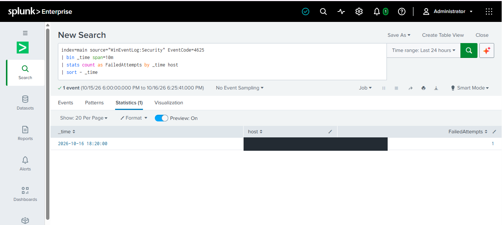

### Seven-day failed authentication search
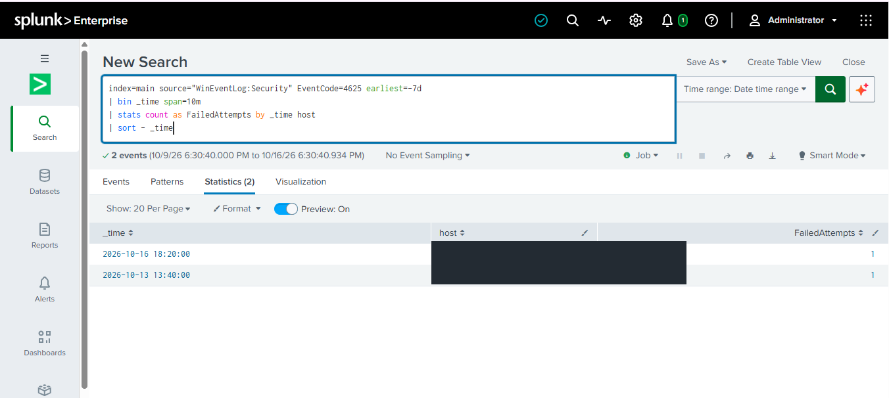

### Microsoft Defender EICAR detection and remediation
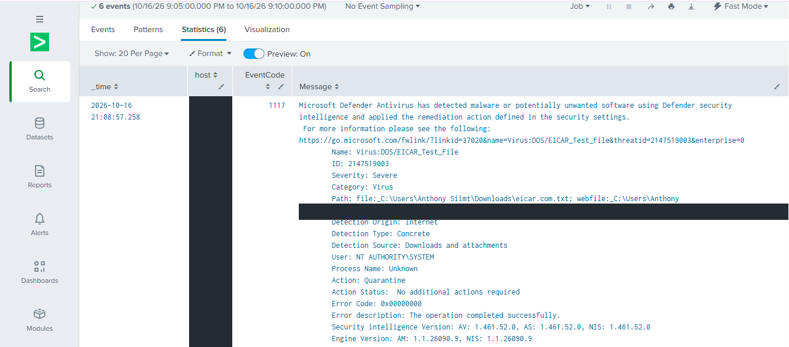

### Windows security monitoring dashboard
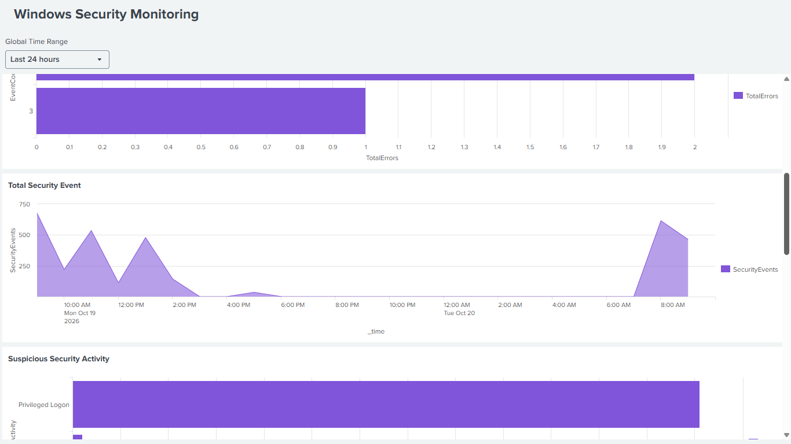

### Ubuntu log ingestion
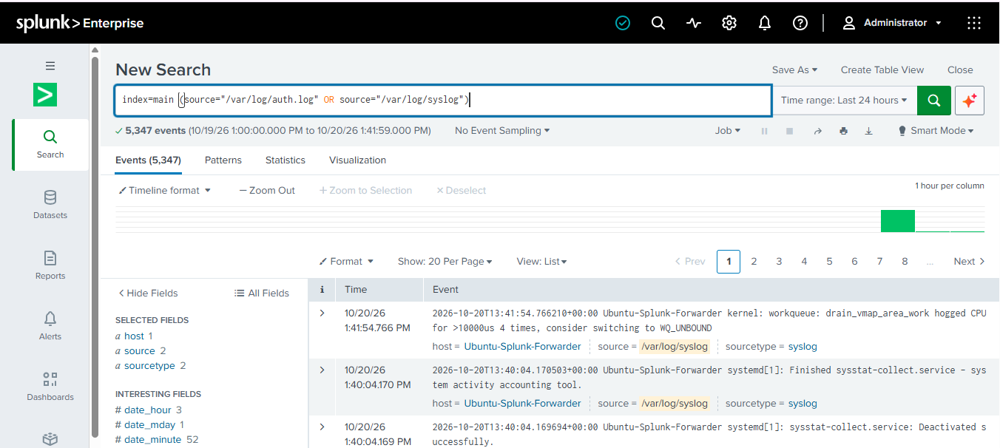

### Linux sudo command monitoring
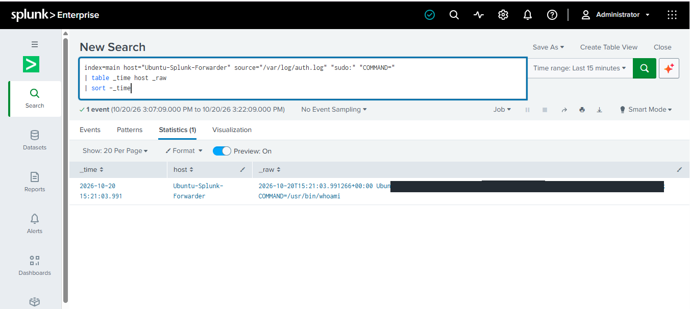

### Combined Windows and Ubuntu event collection
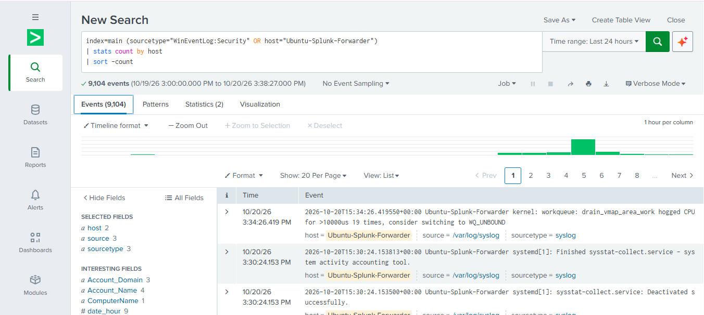

### Event volume comparison by host
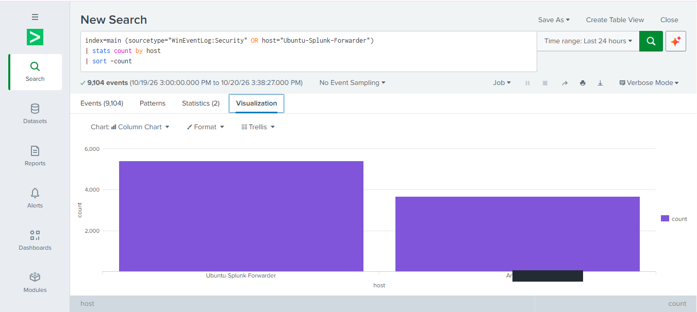

### Security event investigation
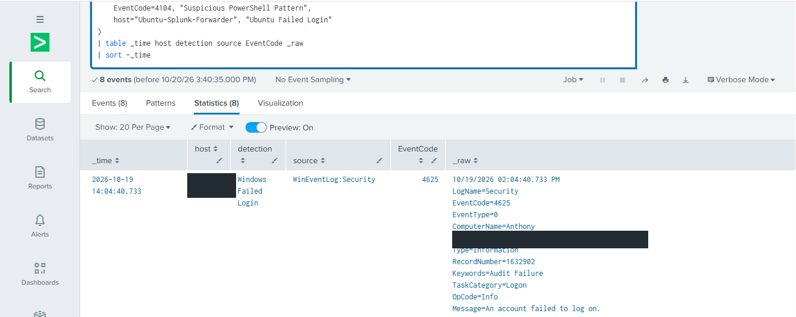

### Sysmon telemetry collection
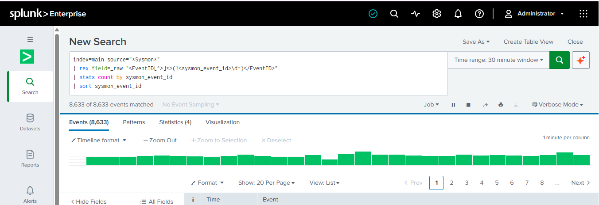

### Process creation and application monitoring
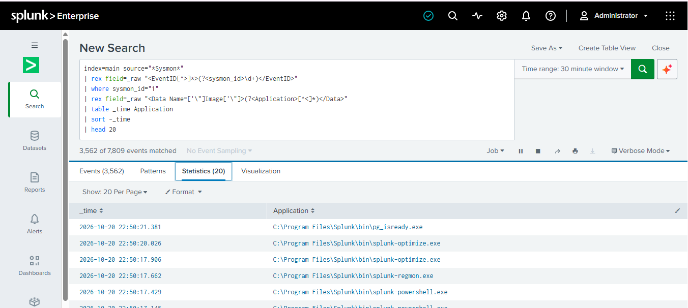

### Application-specific process search
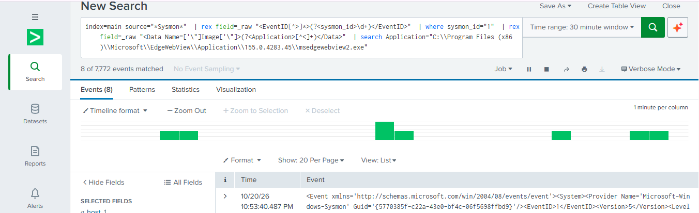

### Splunk Audit Trail user monitoring (app dashboard)
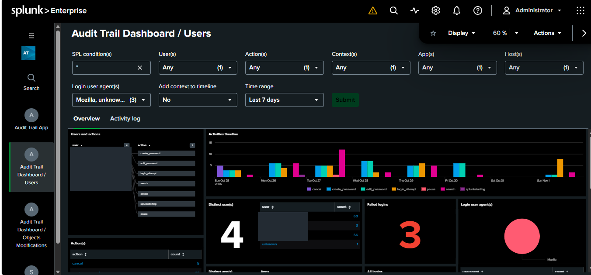

### Application execution summary
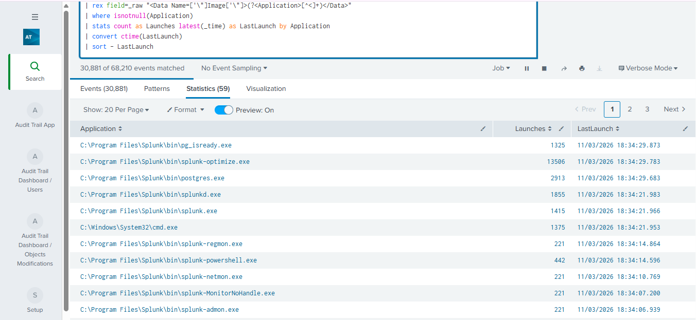

### DNS query analysis
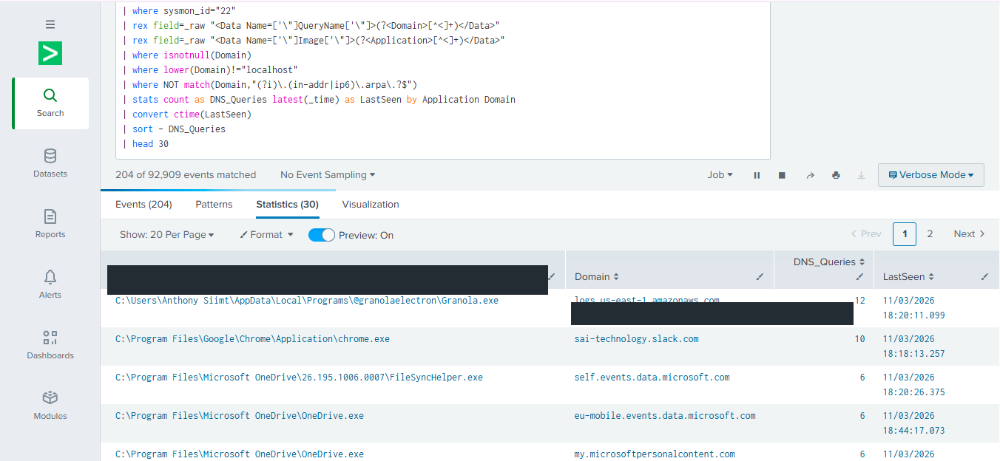

### Network connection monitoring (destination IPs masked)
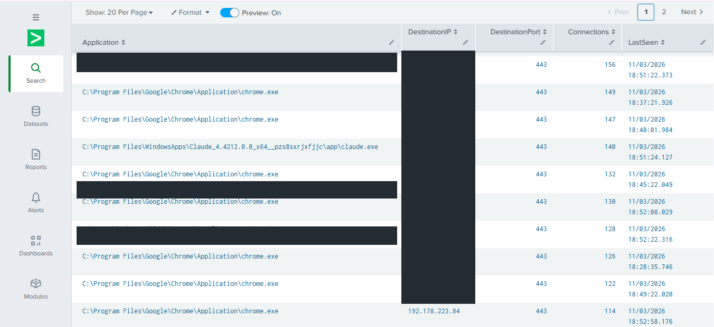

### Windows host monitoring dashboard
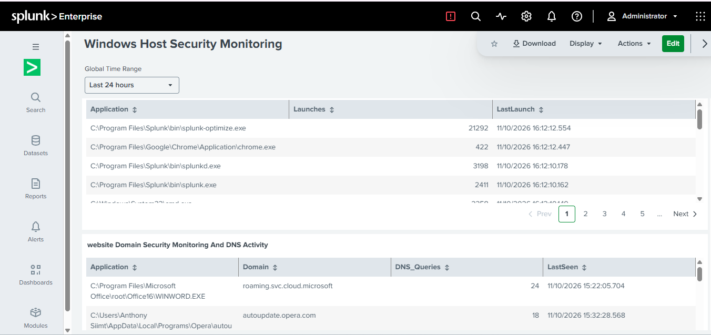

### URLhaus lookup enrichment
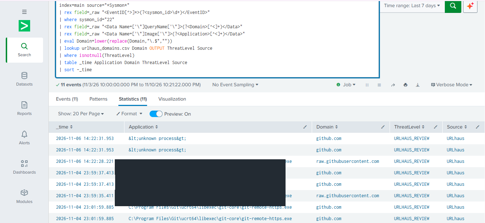

### Shared-hosting domain manual triage
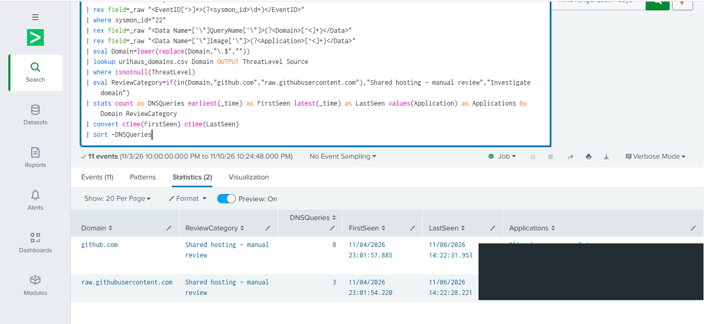

## Skills demonstrated
SIEM deployment, log collection, SPL, Windows and Linux security monitoring, endpoint analysis, dashboard development and threat intelligence triage.
