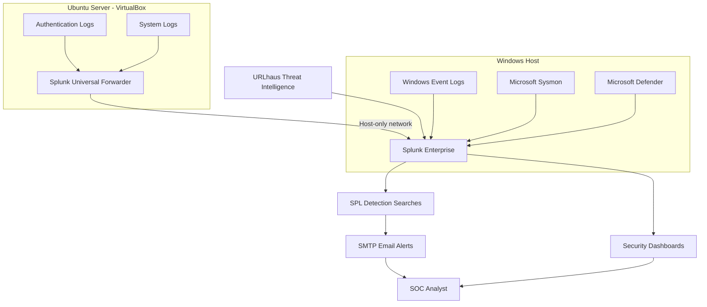

# SOC Home Lab Network Architecture

## Architecture Overview

The lab uses a centralized Splunk Enterprise deployment to collect, analyze and monitor security events from Windows and Ubuntu systems.

## Network Architecture Diagram

## Infrastructure Components

| Component | Purpose |
|---|---|
| Windows Host | Primary monitored endpoint |
| Ubuntu Server | Linux security monitoring |
| VirtualBox | Virtualization environment |
| Splunk Enterprise | Centralized SIEM platform |
| Universal Forwarder | Linux log forwarding |
| Sysmon | Endpoint activity monitoring |
| Microsoft Defender | Malware detection and remediation |
| URLhaus | Threat intelligence enrichment |
| SMTP | Automated email notifications |

## Security Monitoring Workflow

1. Windows and Ubuntu generate security events.
2. Logs are collected and indexed in Splunk.
3. SPL queries analyze authentication, processes and network activity.
4. Threat intelligence lookups identify indicators requiring investigation.
5. Configured alerts notify the analyst.
6. Dashboards support investigation and reporting.

## Monitored Security Events

- Windows failed authentication
- Malware detection and quarantine
- Linux privileged command execution
- Application execution
- DNS queries
- Network connections
- User audit activities
- Suspicious security events

## Security Event References

| Data Source | Event ID | Description |
|---|---|---|
| Windows Security | 4625 | Failed logon |
| Windows Security | 4624 | Successful logon |
| Microsoft Defender | 1116 | Malware detection |
| Microsoft Defender | 1117 | Remediation action |
| Sysmon | 1 | Process creation |
| Sysmon | 3 | Network connection |
| Sysmon | 22 | DNS query |

## Project Scope

This architecture represents a controlled SOC home lab environment for practical cybersecurity training and security monitoring.
