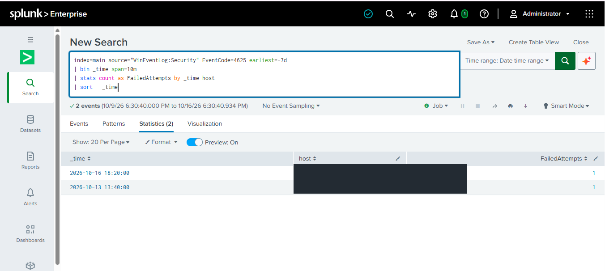
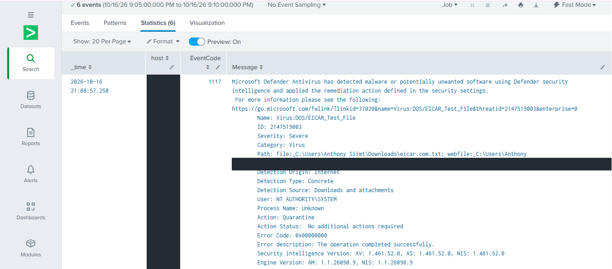
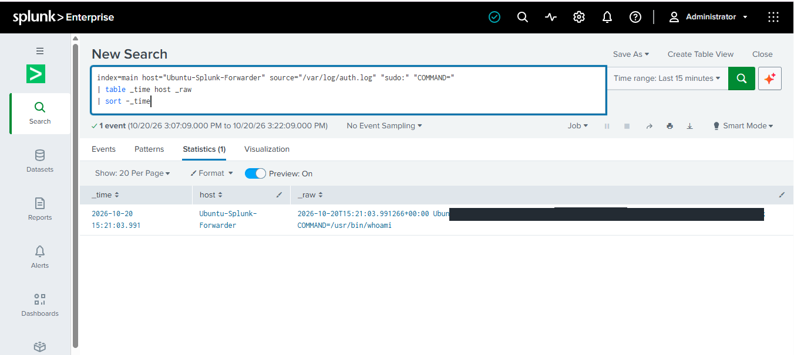
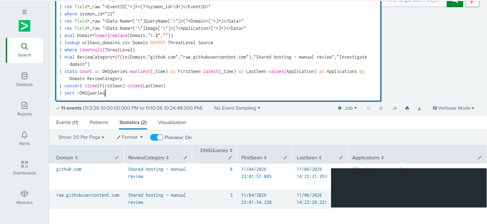

# SOC Security Incident Investigation Reports

## Case 001: Windows Failed Authentication

### Incident Details
- Incident ID: SOC-001
- Date: October 16, 2026
- Data Source: Windows Security Event Logs
- Event ID: 4625
- Severity: Low
- Status: Detected

### Investigation
Splunk identified two failed Windows authentication events during a seven-day search.

### Findings
The events confirm unsuccessful authentication attempts. The available evidence does not establish a brute force attack or unauthorized access.

### Recommended Actions
- Review affected user accounts.
- Monitor repeated authentication failures.
- Configure threshold-based alerts.
- Enforce strong authentication policies.

### Evidence

---

## Case 002: Malware Detection and Remediation

### Incident Details
- Incident ID: SOC-002
- Date: October 16, 2026
- Data Source: Microsoft Defender
- Event IDs: 1116 and 1117
- Classification: Controlled antivirus test
- Status: Successfully quarantined

### Investigation
Microsoft Defender detected the EICAR antivirus test file. Splunk collected the detection and remediation events.

### Findings
- Threat name: Virus:DOS/EICAR_Test_File
- Remediation action: Quarantine
- Action result: Successful
- Additional actions required: None

The EICAR file is a benign test file used to validate antivirus functionality.

### Recommended Actions
- Maintain updated antivirus signatures.
- Monitor malware detection events.
- Investigate unsuccessful remediation attempts.

### Evidence

---

## Case 003: Linux Privileged Command Monitoring

### Incident Details
- Incident ID: SOC-003
- Date: October 20, 2026
- Data Source: Ubuntu Authentication Logs
- Classification: Privileged activity
- Status: Observed

### Investigation
Splunk identified a sudo command execution recorded in the Ubuntu authentication log.

### Findings
The monitored user executed the whoami command with root privileges. The event demonstrates visibility into privileged command execution.

No malicious activity was established.

### Recommended Actions
- Monitor privileged account activity.
- Review sudo permissions.
- Investigate unexpected administrative commands.

### Evidence

---

## Case 004: Threat Intelligence Investigation

### Incident Details
- Incident ID: SOC-004
- Date: November 10, 2026
- Data Source: Sysmon DNS Events
- Intelligence Source: URLhaus
- Event ID: 22
- Status: Manual review required

### Investigation
DNS events were compared against a URLhaus domain lookup using Splunk SPL.

### Findings
Eleven matching DNS events were identified:

- github.com: 8 matches
- raw.githubusercontent.com: 3 matches

Both domains provide shared hosting services and were categorized for manual review.

The matches alone do not establish malicious activity or endpoint compromise.

### Recommended Actions
- Investigate associated processes.
- Review specific URLs where available.
- Correlate DNS activity with endpoint events.
- Reduce false positives through contextual analysis.

### Evidence

---

## Investigation Summary

| Incident | Category | Outcome |
|---|---|---|
| SOC-001 | Authentication | Failed logons detected |
| SOC-002 | Antivirus validation | Successful quarantine |
| SOC-003 | Privileged activity | Command execution observed |
| SOC-004 | Threat intelligence | Manual review required |

## Skills Demonstrated

- Security event investigation
- Alert triage
- Threat intelligence analysis
- Endpoint monitoring
- Incident classification
- False positive identification
- Security reporting
- Evidence documentation

## Scope

These investigations were conducted in a controlled SOC home lab. They represent practical security monitoring exercises rather than confirmed production security incidents.
